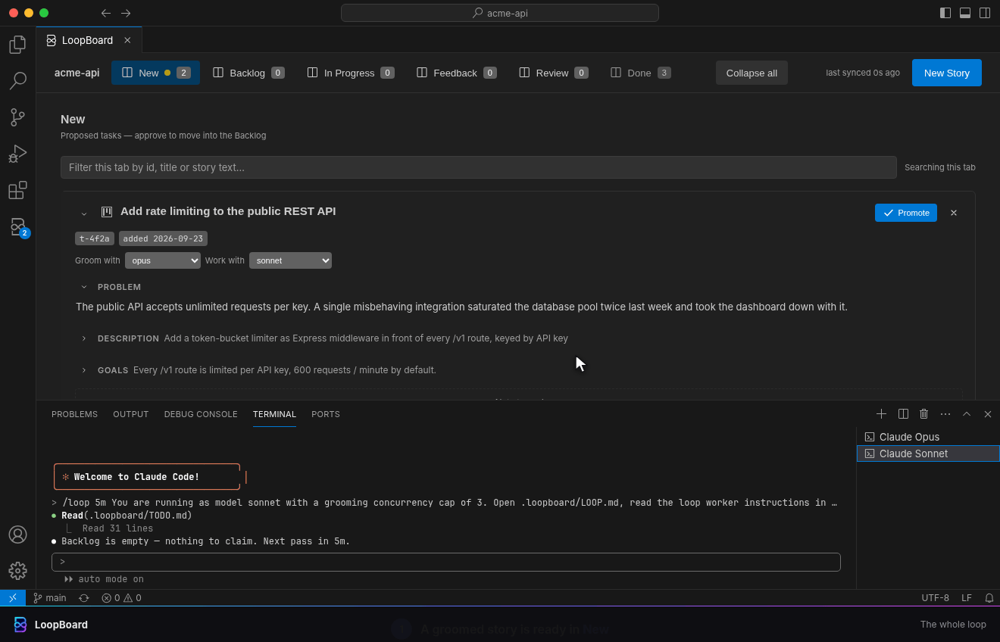

<div align="center">


# LoopBoard

[](https://github.com/SinnConsulting/LoopBoard/actions/workflows/publish.yml) [](https://github.com/SinnConsulting/LoopBoard/actions/workflows/release.yml) [](https://github.com/SinnConsulting/LoopBoard/blob/main/LICENSE) [](#what-runs-on-your-machine) [](https://www.reddit.com/r/LoopBoard/)

**Turn your backlog into reviewed code with Claude Code.**

Write tasks. Answer questions. Review the results.<br>
Manage the whole workflow from a board in VS Code.

[](https://vscode.dev/redirect?url=vscode:extension/SinnConsulting.loopboard-todo) [](https://marketplace.visualstudio.com/items?itemName=SinnConsulting.loopboard-todo)

[Quick start](#try-your-first-task) · [Feature demos](https://github.com/SinnConsulting/LoopBoard/blob/main/docs/showcase/README.md) · [Community](https://www.reddit.com/r/LoopBoard/)

*Requires VS Code 1.90+ and a logged-in Claude Code CLI 2.1.292+.*

</div>

LoopBoard gives Claude Code a queue of work and gives you a place to steer it. Describe a task in
plain language. Claude develops the plan, raises questions, implements the task, and brings the
result back for review. You choose what starts and decide what ships.

Tasks, questions, and delivery notes live in Markdown files inside your project. Open them in
your editor, change them by hand, or follow everything on the board.

## See the workflow

<p align="center">
  <a href="https://raw.githubusercontent.com/SinnConsulting/LoopBoard/main/docs/showcase/gifs/01-the-loop.gif"></a>
</p>

**Describe → Promote → Build → Review → Approve**

*This 17-second demo uses the real board UI with simulated Claude activity. It shows the earlier
per-model terminals; today's workflow uses one Orchestrator terminal that delegates to agents.*

## Try your first task

1. **Install [LoopBoard](https://marketplace.visualstudio.com/items?itemName=SinnConsulting.loopboard-todo)** and open your project in VS Code. Make sure the Claude Code CLI is installed and logged in.
2. **Initialize the workspace.** Run `LoopBoard: Initialize Workspace` from the Command Palette, then `LoopBoard: Open Board`.
3. **Add a small task.** Click **New Story** and describe an improvement with a clear result. For example:

   > Add a clear empty state to the search results page. When a search has no matches, show
   > “No results found” and a button to clear the search. Add a test for that behavior.

4. **Start the loop.** Press **▶** beside **Orchestrator** in the sidebar. Claude expands the task into a plan and goals. Answer any questions on the card.
5. **Promote it when you're happy with the plan.** Claude takes work from the Backlog, implements it on a task branch, and delivers it to **Review**.
6. **Review the result.** Read the delivery notes and inspect the code. Leave feedback for another pass, or click **Approve** to archive the task. Merge the code yourself when you're ready.

LoopBoard creates a `.loopboard/` folder for your tasks and workflow. Add `.loopboard/` to your
`.gitignore` if you want to keep this working state local; this is recommended, and the extension
leaves that choice to you.

## Keep work moving, with decisions in your hands

**A queue Claude can work through.** Capture tasks as they occur to you, then promote the ones
you want built. Drag Backlog cards to set their order. Implementation runs one task at a time.

**Questions stay with the task.** When work needs your input, the task moves to **Feedback**.
Answer on the card and the loop can resume with that context.

**Review has a place in the workflow.** Each delivery reports against the task's goals. An
optional review agent checks the work before it reaches you. Your feedback sends it back for
another pass; approval archives the task to `DONE.md`. Merging remains your decision.

**Your project keeps its history.** The board reflects plain Markdown in `.loopboard/`. Task
descriptions, goals, questions, and delivery notes remain available after the extension is gone.

## Make it fit the way you work

| You want to… | LoopBoard gives you… |
|---|---|
| Explain a visual change | Paste, drop, or attach screenshots to a story |
| Choose how agents work | Model and effort controls for planning and implementation, plus a reviewer choice |
| Keep related work together | Tags, colors, filtering, and a tag progress view |
| Adjust priorities | Drag to reorder New or Backlog tasks; demote unclaimed work |
| Manage a longer session | Context monitoring, restart controls, and scheduled loop actions |
| Set project conventions | Workspace instructions in `.loopboard/LOOP.md` that loops re-read each pass |

Choose defaults on the sidebar's **Settings** page, then override them for individual tasks.
The Orchestrator coordinates planning, implementation, and review through subagents; each role
can use the model you've selected.

[Explore the feature demos →](https://github.com/SinnConsulting/LoopBoard/blob/main/docs/showcase/README.md)

## What runs on your machine

LoopBoard is an MIT-licensed VS Code extension with zero runtime dependencies. It launches your
own Claude Code CLI in a VS Code terminal. Agent activity uses your Claude Code access and counts
toward its usage limits; longer sessions and additional review passes mean more usage.

Choose a permission mode appropriate for the work you're delegating. Permission settings belong
to your VS Code user settings, so a cloned repository cannot raise them. Before starting a loop
in an unfamiliar project, read its `.loopboard/LOOP.md` and task instructions: these tell the
agent what to do on your machine.

[Read the security model →](https://github.com/SinnConsulting/LoopBoard/blob/main/docs/guide.md#security-model)

## Help and reference

| Looking for… | Go to… |
|---|---|
| Every setting and model option | [Settings reference](https://github.com/SinnConsulting/LoopBoard/blob/main/docs/guide.md#settings) |
| The files behind the board | [File structure](https://github.com/SinnConsulting/LoopBoard/blob/main/docs/guide.md#file-structure) |
| Project-specific instructions | [Workspace custom rules](https://github.com/SinnConsulting/LoopBoard/blob/main/docs/guide.md#workspace-custom-rules) |
| Model and effort behavior | [Subagent configuration](https://github.com/SinnConsulting/LoopBoard/blob/main/docs/guide.md#subagent-model-and-effort) and [FAQ](https://github.com/SinnConsulting/LoopBoard/blob/main/FAQ.md) |
| A problem starting the loop | Check `claude --version`; the CLI must meet the minimum version above |
| A reproducible bug | [Open a GitHub issue](https://github.com/SinnConsulting/LoopBoard/issues) |
| Questions, ideas, or something you built | [Join r/LoopBoard](https://www.reddit.com/r/LoopBoard/) |

Loop terminals close with the VS Code window. Open the project and press **▶** to start again;
your task state stays in `.loopboard/`.

## Build and contribute

Contributions and reproducible bug reports are welcome. Development uses Docker or Apple Container, `make`, Git,
and VS Code; the toolchain runs in containers. The Makefile uses Docker when installed, otherwise Apple Container.

```sh
make install    # Install development dependencies in a container
make check      # Build and run tests
make package    # Build an installable .vsix
```

Use **F5** to launch an Extension Development Host.
[See the contributor instructions](https://github.com/SinnConsulting/LoopBoard/blob/main/docs/guide.md#build--contribute) for more detail.

---

**Have a task you've been putting off? Give it a place on the board.**

[Install LoopBoard](https://marketplace.visualstudio.com/items?itemName=SinnConsulting.loopboard-todo) · [Share what you build](https://www.reddit.com/r/LoopBoard/)
