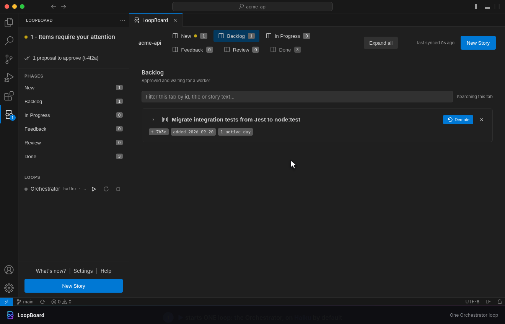
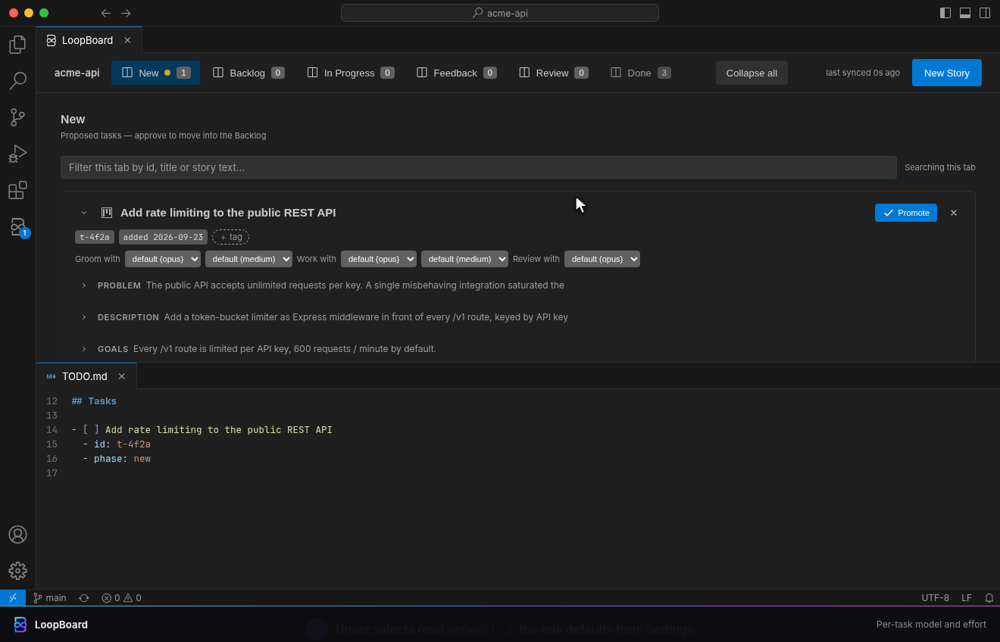
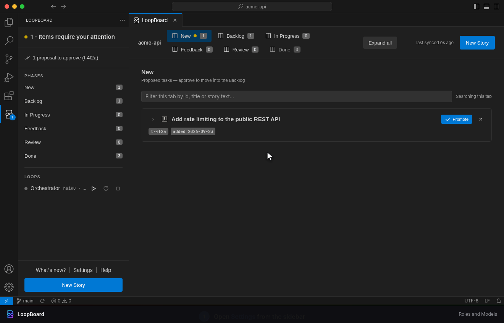

# LoopBoard v4: one Orchestrator loop, every task on its own model

LoopBoard 4.0.0 is a breaking release. The per-model loops are gone: one **Orchestrator** loop now
runs the whole board, and every task says which model and effort grooms it, builds it and reviews
it. This page covers what changed, why, and what you need to do after updating.

## What changed

### One Orchestrator loop instead of one loop per model

Before v4, ▶ opened one terminal per model slot (`Claude Opus`, `Claude Sonnet`, `Claude Fable`).
Each loop owned a role: the Opus loop groomed, the Sonnet loop claimed and built. A task's model
decided which terminal picked it up.

In v4 the sidebar has ONE row, **Orchestrator**, and ▶ opens ONE terminal, `Claude Orchestrator`:

```sh
claude --permission-mode auto --model 'haiku' --effort medium --name loopboard-orchestrator-<id> \
  '/loop 5m You are the LoopBoard orchestrator, grooming cap 3. Models: opus low-xhigh, haiku. ...'
```

The Orchestrator never edits code. Every groom, implementation and review is a **subagent** that
it spawns on the task's own model and effort. It re-reads `.loopboard/LOOP.md` every pass, as
before.

<p align="center">
  <a href="orchestrator.gif"></a>
</p>

The sidebar names what runs, the same way Claude Code names the subagent:

- **Agents** rows: `<groom|work|review> <model>-<effort>-<task id>: <title>`, for example
  `work opus-high-t-7b3e: Migrate integration tests`.
- **In Progress** rows: `<model>-<effort>-<task id>: <title>`, with the effort already clamped
  into that model's range (see below).

### Per-task model, effort and reviewer

Every card (and the New Story composer) has three selects, two of them with an effort beside them:

| Select | Index line | Values |
|---|---|---|
| **Groom with** + effort | `groomer:`, `groomer-effort:` | a model, or `none` (on hold); `low`..`xhigh` |
| **Work with** + effort | `model:`, `effort:` | a model; `low`..`xhigh` |
| **Review with** | `reviewer:` | a model, or `none` (no review); runs at the worker's effort |

A select left on `default (...)` writes nothing to `TODO.md` and uses the role default from the
settings page. Every pick is one line on the task's index entry, so the file stays the source of
truth.

<p align="center">
  <a href="task-routing.gif"></a>
</p>

### Haiku is a full task model

Haiku (`claude-haiku-5-5` behind the `haiku` alias) can groom, build and review, and it is the
**default Orchestrator model**. Before v4 Haiku was not a task model at all. It was verified with
Claude Code 2.1.296: a Haiku session starts under every permission mode LoopBoard offers, and a
Haiku subagent can write and edit files under `--permission-mode auto`. One caveat: under `plan`
the CLI runs a Haiku session on Sonnet, and no orchestrator can work in plan mode anyway.

### No `auto`: nothing picks a model or effort for you

There is no `auto` value anywhere: not on `model:`, `effort:`, `groomer:`, `groomer-effort:` or
`reviewer:`, and not in any setting. A spawn gets the task's own field, else the role default.
Complexity is recorded instead of acted on: the groomer and the implementer each write
`complexity-groomer:` / `complexity-worker:` (for example `high (D)`) into the task file's Meta, so
you can calibrate your defaults from real data.

### New defaults

| Role | Model | Effort |
|---|---|---|
| Orchestrator | Haiku | medium, grooming cap 3 |
| Groomer | Opus | medium |
| Worker | Opus (was Sonnet) | medium |
| Reviewer | Opus (was off) | the worker's |

| Model | On by default | Effort range |
|---|---|---|
| Opus | yes | `low`..`xhigh` |
| Haiku | yes | `low`..`max` |
| Sonnet | no | `low`..`max` |
| Fable | no | `low`..`max` |

Turn Sonnet or Fable on in the settings page to offer them on the board. A task that already names
a model that is off keeps it.

### The settings page: Roles and Models

The settings page is now two tables of dropdowns:

- **Roles**: the model and effort of the Orchestrator (plus its grooming cap) and the defaults for
  the groomer, worker and reviewer.
- **Models**: each model on or off, an optional **model id** its alias resolves to (passed to the
  terminal as `ANTHROPIC_DEFAULT_<MODEL>_MODEL`, so it reaches the session and every subagent), and
  a **lowest** and **highest effort**. Every spawn on that model is clamped into that range.

<p align="center">
  <a href="settings.gif"></a>
</p>

### Config migration

Activation migrates old keys by default: with `loopBoard.autoMigrateSettings` on, every move and
removal below is applied once when the window loads, and a popup says how many. Only a conflict
(old and new key both set by you) or a blind removal of a key VSCode cannot read is left for you:
the settings page counts those in a warning banner and on the **Migrate Config** button, and
**Review migration** lists every change before anything is written. With the setting off, old keys
keep working until you migrate them (they are read as fallbacks, never written).

| Old key | Becomes |
|---|---|
| `loopBoard.models.opus.effort`, `.groomConcurrency` | `loopBoard.orchestrator.effort`, `.groomConcurrency` |
| `loopBoard.models.<model>.model` (custom `--model` string) | `loopBoard.models.<model>.modelId` |
| `loopBoard.models.sonnet.*` / `fable.*` effort and grooming cap | removed (nothing carried) |
| `loopBoard.delegateReview: true` / `false` | `loopBoard.defaultReviewerModel: opus` / `none` |
| `loopBoard.delegateWork` | removed (delegation is always on) |
| `loopBoard.afterTask`, `autoRecycle`, `clearSessionAfterTask` | removed |

Also gone: the after-task recycle or clear. Finishing a task no longer restarts the Orchestrator
terminal; ♻, the context-limit restart, the idle stop and scheduled actions are unchanged.

## What you need to do

1. Update the extension and reload the window. If old `Claude Opus` / `Sonnet` / `Fable` terminals
   survived the update, LoopBoard asks once to stop them.
2. Sync `.loopboard/LOOP.md` (automatic on activation while `loopBoard.autoSyncTemplates` is on, or
   **Synchronise Templates** on the settings page). A surviving per-model loop that reads the new
   file stands down by itself. Custom rules that talk about per-model loops need a hand edit.
3. Old settings migrate on that reload. Open **Settings** only if the banner shows a conflict or
   a blind removal left for you.
4. Press ▶ on the **Orchestrator** row. You need Claude Code **2.1.292+** (per-spawn effort).

## The benefit

- **The right model per task, not per terminal.** A one-line fix and a risky migration no longer
  have to share the Sonnet loop's model. Each task carries its own groomer, worker, reviewer and
  effort, visible on the card and in `TODO.md`.
- **One terminal to watch, one context to manage.** One session, one context bar, one restart
  schedule. Busy means "a task In Progress or a live subagent", so a restart never cuts a subagent
  off mid-edit.
- **A cheap coordinator, strong workers.** The Orchestrator only reads the board and spawns
  subagents, so it runs on Haiku; the expensive models are spent where the code is written and
  reviewed. Work runs in subagents with fresh context, so a long session no longer drags old
  tasks into new ones.
- **Review by default.** Every delivery gets a review subagent on Opus unless you say `none`.
- **Predictable spend.** Nothing is picked automatically. The model and effort that run are the
  ones on the card or in Settings, and each model's effort range caps what any spawn can use.
- **You can see what runs.** Sidebar rows and Claude Code's agent list carry the same
  `role model-effort-task` name, and the transcript's `"effort"` field is the ground truth.

## About the recordings

The GIFs run the extension's real webview code (`media/board.js`, `media/sidebar.js`,
`media/settings.js`) in headless Chromium, answered by the same pure modules the extension ships;
the Claude sessions in the terminal are simulated (VS Code cannot read a terminal). Re-record them
in Docker with `make showcase SCENES="v4"`; the scenes are `docs/showcase/studio/articles/v4-*.js`.
